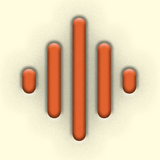
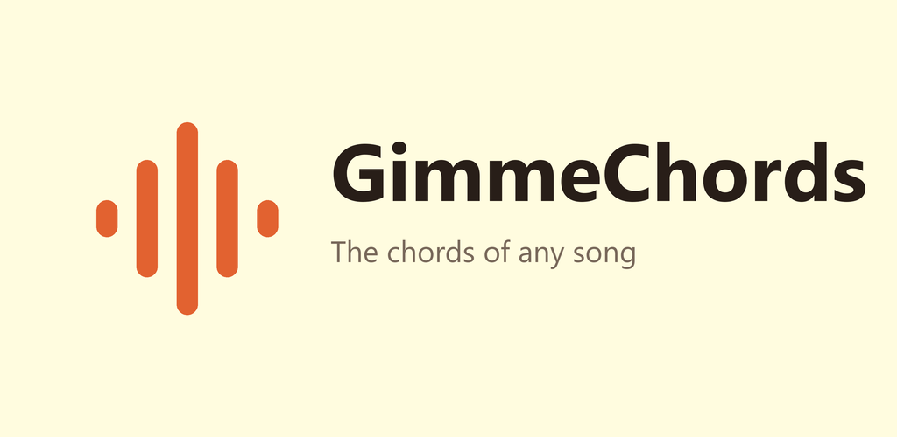
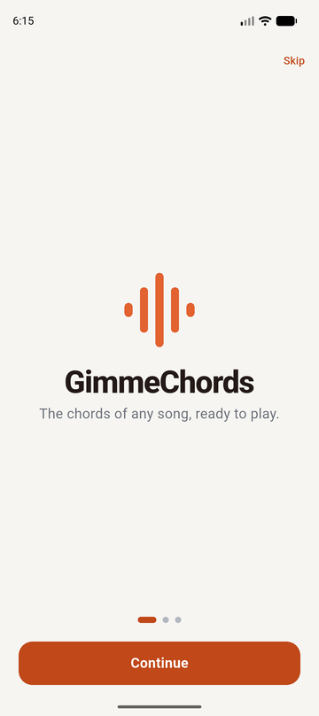
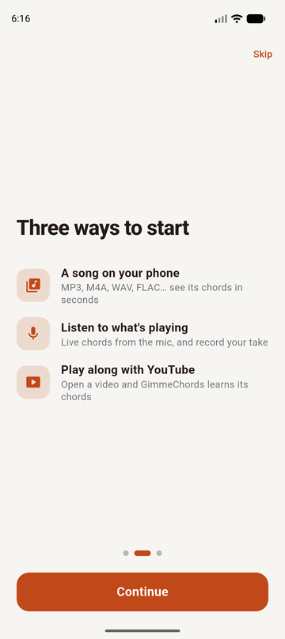
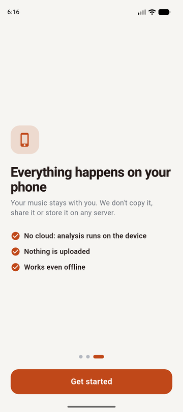
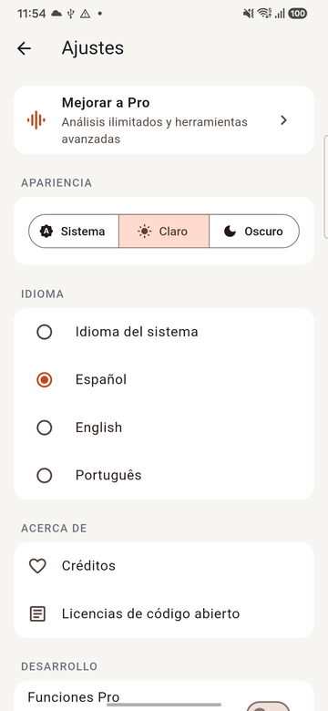
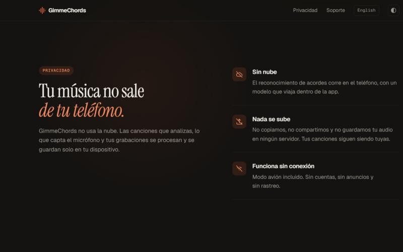
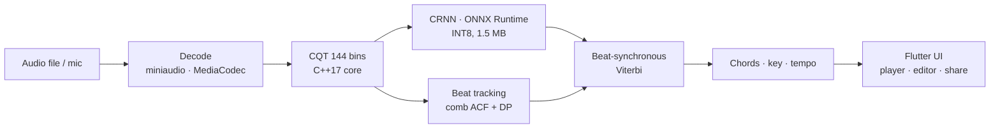
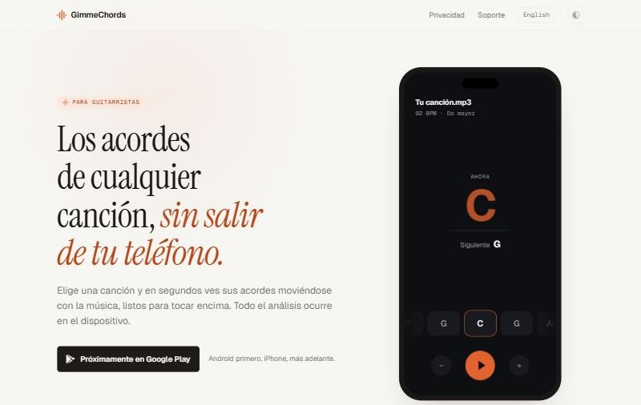

<p align="center">
  
</p>

<h1 align="center">GimmeChords</h1>

<p align="center">
  <strong>The chords of any song, without leaving your phone.</strong><br/>
  On-device chord recognition for guitarists — no cloud, nothing uploaded.
</p>

<p align="center">
  <a href="https://gimmechords.aexelm.online">Website</a> ·
  <a href="https://gimmechords.aexelm.online/privacy/">Privacy</a> ·
  <a href="#español">Español</a>
</p>

<p align="center"></p>

> This is a **showcase** repository: screenshots, architecture and design notes. The source code
> is private; the snippets below are deliberately incomplete excerpts and cannot be built.

---

## What it does

Pick a song on your phone and, in seconds, GimmeChords shows its chords moving with the music —
current chord big, the next one below, a guitar diagram and a scrubbable chord lane. Everything,
from audio decoding to the neural network, runs **on the device**.

- **Any song** — MP3, M4A, AAC, WAV, FLAC, OGG, OPUS.
- **Listen mode** — live chords from the microphone (~0.8 s latency); record your take and keep it
  with its chords (stored as AAC, ~7× smaller than WAV).
- **Play along with YouTube** — via the official embedded player; the first play listens, later
  plays show the chords ahead of time. No audio is ever downloaded.
- **Key, capo, speed** — transpose or add a capo and chords follow; slow down without changing pitch.
- **Editor** — fix any chord; corrections stay on the phone.
- **Guitar tuner** — YIN pitch detection accurate to a few cents on a phone mic, reference tones,
  standard tuning free and alternative tunings (drop D, DADGAD, open G…) in Pro.
- **A-B loop**, **share** (WhatsApp, email, file), **light/dark**, **es / en / pt**.

<p align="center">
  
  
  
  
</p>

## Privacy by architecture

There is no backend that receives audio. Songs, microphone input and recordings are processed
and stored only on the device; the app works in airplane mode. The only network traffic is the
official YouTube player (when used) and the store/RevenueCat for purchases.

<p align="center"></p>

## Architecture



| Layer | Technology |
|---|---|
| UI | Flutter (Dart 3), custom design system, spring physics, reduced-motion aware |
| Audio/DSP core | C++17 via `dart:ffi` — decoding, constant-Q transform, beats, Viterbi, key |
| Inference | ONNX Runtime Mobile, INT8 model shipped inside the app |
| Native | Kotlin (MediaCodec decoder/encoder), Swift planned |
| Monetization | Freemium + subscription through RevenueCat, behind a feature-gate seam |
| Website | SvelteKit 3, fully static, self-hosted fonts |

## The recognition pipeline

1. **Decode and resample** to 22.05 kHz mono.
2. **Constant-Q transform**: 6 octaves × 24 bins/octave, hop 1024, with tuning estimation —
   implemented from scratch in C++ and verified against the Python reference (relative error ≈ 2·10⁻⁷).
3. **CRNN** (≈ 542k parameters) predicts one of **109 classes** per frame:
   N + 12 roots × {maj, min, 7, maj7, m7, sus4, sus2, dim, aug}.
4. **Beat tracking** and a **beat-synchronous Viterbi**: chords may change cheaply on beats and
   are expensive to change between them, which removes flicker.
5. **Key estimation** from the decoded chords, used for transposition and capo.

### Training data that can be used commercially

Many chord datasets are research-only. The model was trained on **3,000 procedurally generated
songs** rendered with a General MIDI soundfont plus **GuitarSet** (CC BY 4.0), with pitch-shift and
noise/reverb augmentation for microphone input.

| Model | Held-out GuitarSet (maj/min) | Size |
|---|---|---|
| v1 | 0.217 | — |
| v2 CRNN, INT8 | 0.594 (0.794 on comparable classes) | 1.5 MB |
| **v3** (v2 fine-tuned for phone mics) | **0.594**, and 3.7–5× better on quiet phone audio | 1.5 MB |

### Making a phone microphone usable

A phone's raw microphone delivered a guitar about 35 dB below anything the model had seen in
training. An automatic gain stage (capped at +40 dB so room noise isn't amplified), a high-pass
filter and a spectral noise gate took simulated phone takes from **15.9% to 96.7%** maj/min
accuracy; v3 adds robustness for audio that skips that stage.

## Selected excerpts

*Truncated on purpose — these are illustrations, not buildable code.*

**Beat-aware transition prior (C++ core)**

```cpp
// Chords change cheaply on beats only.
constexpr double kSelfProbOnBeat  = 0.7;
constexpr double kSelfProbOffBeat = 0.995;

std::vector<int> Viterbi(const std::vector<float>& probs, int frames, int classes,
                         const std::vector<double>& self_probs) {
  // log-domain DP over frames × classes …
  // … backtrack …
}
```

**The brand mark is the progress indicator (Flutter)**

```dart
/// Five rounded bars; with `active` they move like a level meter while a song is analysed.
class BrandMark extends StatefulWidget {
  const BrandMark({super.key, this.size = 48, this.active = false});
  // Activity eases in/out with a critically damped spring and is skipped under reduced motion …
}
```

**Monetization behind one seam**

```dart
abstract final class Monetization {
  static const freeDailyAnalyses = 3;
  static const proFeatures = {Feature.unlimitedAnalyses, Feature.extendedVocabulary, /* … */};
}
// Screens only ever ask FeatureGate.check(feature); the store lives behind Entitlements.
```

## Design

Interaction design follows Apple's *Designing Fluid Interfaces* principles adapted to Flutter:
springs defined by damping/response, momentum projection on the chord lane, rubber-banding,
interruptible animations, translucent chrome, and a chord switcher that never shows two chord
names at once. Typography and colour are tuned to be readable at ~1 m on a music stand.

<p align="center"></p>

## Quality

- 60 Flutter unit/widget tests, on-device integration tests, C++ core tests.
- Python ↔ C++ parity checks for the DSP front end and decoding.
- Release flow for Google Play prepared (signed AAB, store listing, data-safety answers).

## Roadmap

- Google Play closed testing → production
- iOS build (Core ML / ONNX, AVAudioEngine)
- Smaller binary with a reduced ONNX Runtime build

---

## Español

**GimmeChords** detecta los acordes de cualquier canción **en tu teléfono**: sin nube y sin subir
nada. Elige una canción y en segundos ves sus acordes moviéndose con la música, listos para tocar
encima. También escucha por el micrófono, graba tus interpretaciones, toca encima de vídeos de
YouTube (con el reproductor oficial), transpone, pone cejilla, baja la velocidad y te deja corregir
y compartir los acordes.

Este repositorio es una **vitrina**: capturas, arquitectura y decisiones de diseño. El código fuente
es privado y los fragmentos mostrados están truncados a propósito.

---

<p align="center">
  Made by <strong>AE-Software Developer</strong> · <a href="mailto:aexelm.developer@gmail.com">aexelm.developer@gmail.com</a><br/>
  © 2026 AE-Software Developer. All rights reserved.
</p>
